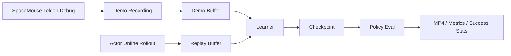

# HIL-SERL MuJoCo：面向插入任务的人在环强化学习工作区


<video controls src="train/backup/20260513/mujoco_insertion.mp4" title="Title"></video>

`hil_serl_mujoco` 是一个围绕 **Franka Panda 插入任务**构建的 Human-in-the-Loop 强化学习工作区。  
仓库围绕一条清晰的研发主线组织：

- 控制器调试
- demo 录制
- actor 在线采样
- learner 分布式训练

当前默认训练是 **state-based insertion RL**。同时，仓库会继续保留相机渲染、eval 视频导出和视觉编码基础设施，方便后续将摄像头图像接入 RL observation。

---

## 项目定位

项目当前聚焦于一条完整的插入任务研发链路：

> **用 SpaceMouse 快速调通控制链，用人工 demo 预热 replay，随后通过 actor / learner 做 HIL-RLPD 训练，并从 checkpoint 做纯策略评估与视频导出。**

当前默认基线：

| 维度 | 当前主线 |
| --- | --- |
| 任务 | Franka Panda peg-in-hole insertion |
| 仿真模型 | `panda_nohand_velocity.xml` |
| 控制方式 | SpaceMouse + task-space velocity control |
| RL 观测 | state-only |
| 训练范式 | demo prefill + online HIL-RLPD |
| 评估产物 | success stats + MP4 + 本地 metrics 曲线 |

---

## 项目亮点

- **单任务聚焦**：仓库围绕 insertion 主线组织，便于持续迭代与复现实验。
- **调试到训练闭环完整**：从 teleop 调试、demo 录制到 actor/learner 训练和 checkpoint eval 已全部打通。
- **控制语义统一**：debug teleop、demo recording、actor/eval 使用同一条 velocity 控制链。
- **相机基础设施完整**：camera render、eval video 和视觉扩展路径已经就位，方便后续接入图像 observation。
- **部署拓扑明确**：支持本地 actor + 远端 learner 的双机工作流。

---

## 系统概览



更直白一点地说：

1. 先在 `sim/` 中把控制链调顺。
2. 录制一批成功的 insertion demos。
3. learner 用 demo 预热。
4. actor 在线采样并允许人工 intervention。
5. 从 checkpoint 做纯策略评估，并导出总视频。

---

## 仓库结构

```text
hil_serl_mujoco/
├── README.md
├── sim/
└── train/
```

### `sim/`

仿真与示教侧仓库，当前主用内容包括：

- MuJoCo 模型与资产
- `FrankaInsertionEnv`
- `panda_nohand_velocity.xml`
- SpaceMouse 接入
- 本地 teleop 调试入口
- insertion demo 录制
- 相机渲染与 eval 展示能力

### `train/`

训练侧仓库，当前主用内容包括：

- `scripts/train_rlpd_mujoco.py`
- `mujoco_insertion` 实验配置
- actor / learner 分布式训练
- checkpoint eval / MP4 导出
- 本地 reward / success / error 曲线

同时包含视觉输入扩展所需的 vision / pixel encoder 基础设施。

---

## 快速开始

### 1. 安装本地 sim 环境

```bash
cd /home/lrb/Workspace/hil_serl_mujoco/sim
./setup_env_sim.sh
conda activate sim_env
```

### 2. 安装本地 actor 环境

```bash
cd /home/lrb/Workspace/hil_serl_mujoco/train
./setup_env_actor.sh
conda activate hil_serl_actor
```

### 3. 安装远端 learner 环境

```bash
cd /root/workspace/hil_serl_mujoco/train
./setup_env_train.sh
conda activate hil_serl_train
```

---

## 典型工作流

### 1. 控制器调试

```bash
cd /home/lrb/Workspace/hil_serl_mujoco/sim
conda activate sim_env

python scripts/debug/teleop_main.py \
  --allow-missing-spacemouse \
  --show-cameras
```

当前 debug 主线只保留：

- SpaceMouse 输入
- velocity 控制
- MuJoCo viewer
- 末端相机窗口

### 2. 录制 insertion demos

```bash
cd /home/lrb/Workspace/hil_serl_mujoco/sim
conda activate sim_env

python scripts/record_demos_mujoco.py \
  --output demo_data/insertion_demos.pkl \
  --num_demos 30 \
  --render-human \
  --realtime \
  --show-cameras
```

默认录制设置已经与训练主线对齐：

- `100 Hz` 控制频率
- `sim_timestep = 0.001`
- `n_substeps = 10`
- 与 debug teleop 共用同一条 velocity 控制链

`--show-cameras` 只用于观察，不会把图像写进 demo 数据集。

### 3. 启动 learner

```bash
cd /home/lrb/Workspace/hil_serl_mujoco/train
conda activate hil_serl_train

python scripts/train_rlpd_mujoco.py \
  --exp_name mujoco_insertion \
  --learner \
  --demo_path /home/lrb/Workspace/hil_serl_mujoco/train/demo_data/insertion_demos.pkl \
  --checkpoint_path /home/lrb/Workspace/hil_serl_mujoco/train/output/mujoco_insertion
```

### 4. 启动 actor

**本地learner**

```bash
cd /home/lrb/Workspace/hil_serl_mujoco/train
conda activate hil_serl_actor

python scripts/train_rlpd_mujoco.py \
  --exp_name mujoco_insertion \
  --actor \
  --ip localhost \
  --checkpoint_path /home/lrb/Workspace/hil_serl_mujoco/train/output/mujoco_insertion_actor \
  --actor_viewer meshcat \
  --actor_render_fps 20
```

**远程learner**

```bash
cd /home/lrb/Workspace/hil_serl_mujoco/train
conda activate hil_serl_actor

python scripts/train_rlpd_mujoco.py \
  --exp_name mujoco_insertion \
  --actor \
  --ip 100.101.102.103 \
  --checkpoint_path /home/lrb/Workspace/hil_serl_mujoco/train/output/mujoco_insertion_actor \
  --actor_viewer meshcat \
  --actor_render_fps 20
```

当前 actor 默认会在达到自身 `max_steps` 后继续采样，直到 learner 回报训练完成，保持在线数据持续更新。

### 5. 训练后评估

```bash
cd /home/lrb/Workspace/hil_serl_mujoco/train
conda activate hil_serl_actor

python scripts/train_rlpd_mujoco.py \
  --exp_name mujoco_insertion \
  --actor \
  --checkpoint_path /home/lrb/Workspace/hil_serl_mujoco/train/output/mujoco_insertion \
  --eval_checkpoint_step -1 \
  --eval_n_trajs 10 \
  --eval_realtime_factor 1.0
```

这里：

- `success_sim_time` 表示 MuJoCo 物理仿真时间
- `success_wall_time` 表示评估执行消耗的墙钟时间

推荐优先看 `success_sim_time`。

### 6. 导出总 MP4

```bash
python scripts/train_rlpd_mujoco.py \
  --exp_name mujoco_insertion \
  --actor \
  --checkpoint_path /home/lrb/Workspace/hil_serl_mujoco/train/output/mujoco_insertion \
  --eval_checkpoint_step -1 \
  --eval_n_trajs 10 \
  --actor_viewer none \
  --eval_video_path /home/lrb/Workspace/hil_serl_mujoco/train/output/eval/mujoco_insertion.mp4
```

当前会把所有 eval episode 顺序拼接到一个总视频中。默认 eval 相机是 `tool_follow_camera`，也可以手动切到 `front` 或 wrist 相机。

---

## 当前能力与扩展方向

### 当前主线能力

- `FrankaInsertionEnv`
- `panda_nohand_velocity.xml`
- SpaceMouse + velocity teleop
- demo 录制
- state-only SAC / RLPD actor + learner
- checkpoint eval / MP4 / 本地 metrics

### 视觉扩展方向

- 末端或场景相机图像作为训练输入
- 基于现有 pixel / vision encoder 路径接入 image observation
- 视觉 RL 训练与评估扩展

当前仓库默认采用 **state-based RL 主线**，并同时提供相机渲染与视觉训练扩展的基础设施。

---

## 推荐使用方式

如果你现在的目标是把 insertion RL 跑顺，推荐直接按下面的节奏推进：

1. 先把 `sim/scripts/debug/teleop_main.py` 调顺
2. 再录一批质量稳定的 demos
3. 再跑 actor / learner
4. 用 checkpoint eval 和 MP4 看策略真实表现
5. 最后再决定是否把相机图像接进 observation

这条路径是当前仓库最稳定、最省心的用法。

---

## 更多说明

- 仿真侧说明见 [sim/README.md](/home/lrb/Workspace/hil_serl_mujoco/sim/README.md)
- 训练侧说明见 [train/README.md](/home/lrb/Workspace/hil_serl_mujoco/train/README.md)
